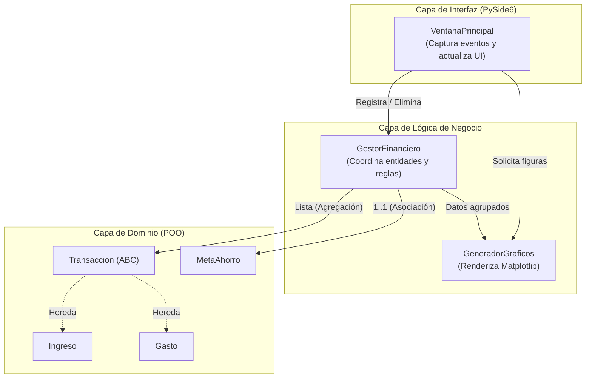
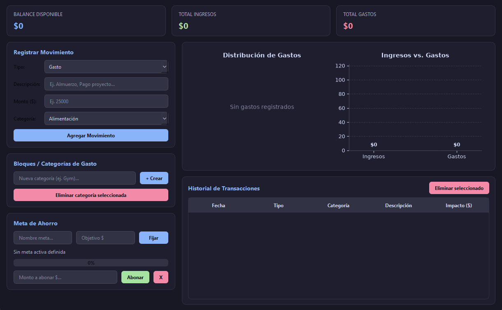

# Finanzas Analyzer — Panel de Control Financiero (POO)

> Aplicación de escritorio desarrollada en **Python** bajo el paradigma de **Programación Orientada a Objetos (POO)** con interfaz gráfica en **PySide6** y visualización analítica mediante **Matplotlib**. Permite gestionar ingresos, gastos categorizados, bloques de presupuesto personalizados y metas de ahorro con actualización visual en tiempo real.

---

##  Tabla de Contenidos

1. [Descripción del Problema](#1-descripción-del-problema)
2. [Objetivos del Proyecto](#2-objetivos-del-proyecto)
3. [Funcionalidades Principales](#3-funcionalidades-principales)
4. [Arquitectura y Diagrama del Sistema](#4-arquitectura-y-diagrama-del-sistema)
5. [Estructura del Repositorio](#5-estructura-del-repositorio)
6. [Tecnologías Utilizadas](#6-tecnologías-utilizadas)
7. [Instalación y Configuración](#7-instalación-y-configuración)
8. [Ejecución y Pruebas](#8-ejecución-y-pruebas)
9. [Manual de Usuario](#9-manual-de-usuario)
10. [Documentación Técnica (Informe)](#10-documentación-técnica)
11. **[Evidencias y Capturas de Pantalla](docs/imagenes/EVIDENCIAS.md)**

---

## 1. Descripción del Problema
El control de finanzas personales suele realizarse de manera desorganizada o mediante hojas de cálculo estáticas que dificultan conocer en tiempo real la liquidez disponible, identificar en qué categorías se concentra el consumo y medir el avance hacia metas financieras concretas. El registro manual sin validaciones suele generar inconsistencias.

**Finanzas Analyzer** resuelve esta necesidad proporcionando un entorno gráfico de escritorio que aplica reglas de negocio estrictas, asegurando la integridad de los datos en memoria y transformándolos instantáneamente en indicadores clave (KPIs) y gráficos estadísticos.

## 2. Objetivos del Proyecto
* **General:** Desarrollar una aplicación funcional en Python que integre los principios de POO y una interfaz gráfica interactiva.
* **Específicos:**
  * Aplicar encapsulamiento, herencia, polimorfismo y abstracción.
  * Separar la lógica de negocio y los modelos de la capa de presentación (UI).
  * Brindar retroalimentación visual mediante gráficos de Matplotlib incrustados en PySide6.

## 3. Funcionalidades Principales
* **Transacciones:** Registro de Ingresos y Gastos con cálculo automático del balance.
* **Categorías:** Creación y eliminación dinámica de categorías de gastos.
* **Metas de Ahorro:** Definición de objetivos con barra de progreso y abonos validados contra el balance.
* **Dashboard:** Visualización en tiempo real con gráficos de dona y barras.

---

## 4. Arquitectura y Diagrama del Sistema

El sistema utiliza una arquitectura por capas. Para leer el análisis profundo de esta arquitectura, dirígete al [Informe Técnico](analizador_de_finanzas/docs/INFORME_TECNICO.md).




---

## 5. Estructura del Repositorio

```text
finanzas_analyzer/
│
├── main.py                         # Punto de entrada de la aplicación
├── requirements.txt                # Dependencias (PySide6, matplotlib, pytest)
├── README.md                       # Este documento
│
├── modelos/                        # Lógica de dominio y entidades
│   ├── transaccion.py              # Clase base y clases hijas
│   └── meta_ahorro.py              # Gestión del objetivo financiero
│
├── servicios/                      # Controladores y lógica de visualización
│   ├── gestor_financiero.py        # Núcleo del estado del sistema
│   └── generador_grafico.py        # Creación de gráficas estadisticas
│
├── interfaz/                       # Componentes visuales
│   └── ventana_principal.py        # GUI principal con tema Catppuccin
│
├── pruebas/                        # Testing automatizado
│   └── test_modelos.py             # Pruebas unitarias de las clases
│
└── docs/                           # Documentación anexa
    ├── INFORME_TECNICO.md          # Informe técnico detallado
    └── imagenes/                   # Capturas de pantalla
```

## 6. Tecnologías Utilizadas
* **Python 3.12+**
* **PySide6** (Interfaz de usuario Qt)
* **Matplotlib** (Generación de dashboard visual)
* **pytest** (Pruebas unitarias)

## 7. Instalación y Configuración

1. Clona el repositorio:
   ```bash
   git clone https://github.com/Sebas-Martinez846/Analizador_de_finanzas.git
   cd finanzas_analyzer
   ```
2. Crea y activa tu entorno virtual:
   ```bash
   python -m venv .venv
   # Windows: .venv\Scripts\activate
   # Mac/Linux: source .venv/bin/activate
   ```
3. Instala las dependencias:
   ```bash
   pip install -r requirements.txt
   ```

## 8. Ejecución y Pruebas
Para abrir la aplicación:
```bash
python main.py
```
Para ejecutar las pruebas y validar el núcleo POO:
```bash
pytest -v
```

## 9. Manual de Usuario
1. **Registrar Movimiento:** Usa el panel izquierdo para añadir un Ingreso o Gasto, indicando la categoría, monto y descripción.
2. **Gestionar Categorías:** Añade nuevas etiquetas para clasificar tus gastos o elimina las que ya no uses.
3. **Fijar Meta de Ahorro:** Escribe el nombre de tu meta (ej. Moto nueva), fija el objetivo, y utiliza el botón "Abonar" para trasladar fondos de tu balance general al ahorro.
4. **Eliminar registros:** Si te equivocas, selecciona la transacción en la tabla inferior derecha y haz clic en "Eliminar seleccionado". Todo se recalcula automáticamente.



---

## 10. Documentación Técnica
Para entender en profundidad cómo se diseñaron las clases, dónde se aplicó el encapsulamiento, el polimorfismo y revisar los resultados de las pruebas técnicas, por favor visita el siguiente enlace:

👉 **[Haz clic aquí para leer el Informe Técnico Completo](docs/INFORME_TECNICO.md)**

---
**Autor:** Sebastian Samuel Martinez Acosta
**Asignatura:** Programación Orientada a Objetos con Python
