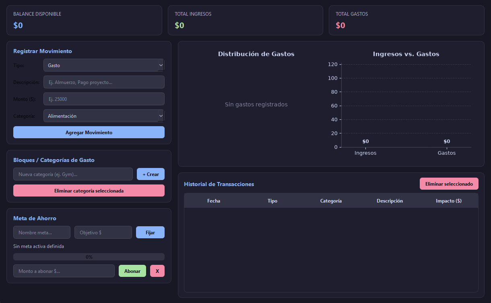
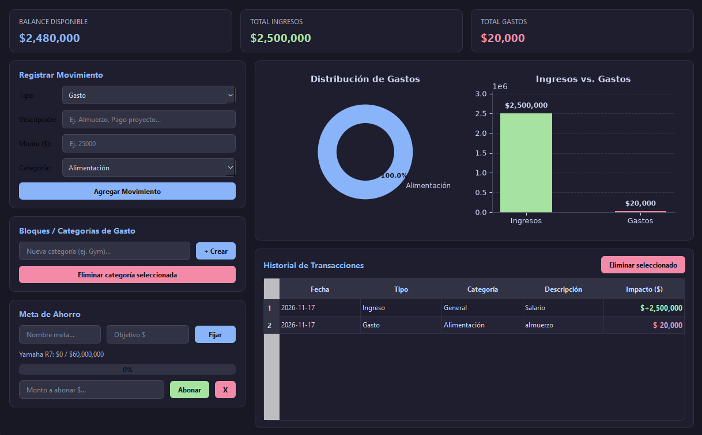
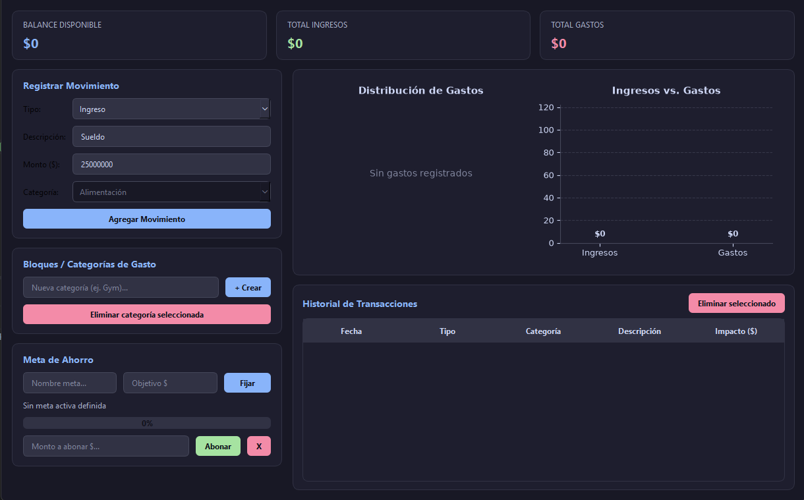
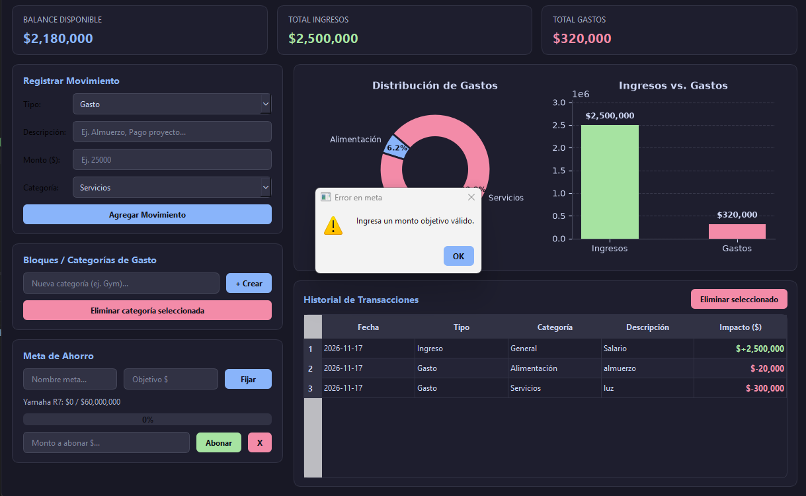

# Galería de Evidencias — Finanzas Analyzer

> **Navegación:** [Volver al README Principal](../../../README.md) | [Ver Informe Técnico](../INFORME_TECNICO.md)

Esta galería recopila las capturas de pantalla que evidencian el funcionamiento integral de la interfaz gráfica, la actualización en tiempo real de los gráficos estadísticos y las validaciones de negocio implementadas mediante Programación Orientada a Objetos.

---

## Vista General en Cuadrícula (2x2)

<table>
  <tr>
    <th align="center" width="50%">1. Dashboard Principal</th>
    <th align="center" width="50%">2. Registro de Movimientos y Gráficos</th>
  </tr>
  <tr>
    <td align="center">
      
       
      <i>Tarjetas de balance disponible, ingresos, gastos y renderizado inicial.</i>
    </td>
    <td align="center">
      
       
      <i>Actualización dinámica de la tabla de historial y gráfico de dona por categoría.</i>
    </td>
  </tr>
  <tr>
    <th align="center" width="50%">3. Entrada de datos</th>
    <th align="center" width="50%">4. Control de Errores y Validaciones</th>
  </tr>
  <tr>
    <td align="center">
      
       
      <i>Espacios para ingresar los datos correspondientes.</i>
    </td>
    <td align="center">
      
       
      <i>Ventana de advertencia (<code>QMessageBox</code>) al detectar entradas inválidas o saldo insuficiente.</i>
    </td>
  </tr>
</table>

---

## Detalle Individual de Capturas

### 1. Dashboard Principal y KPIs

### 2. Registro de Movimientos y Gráficos

### 3. Progreso de Meta de Ahorro

### 4. Control de Errores y Validaciones

---

>[⬆️ Subir al inicio](#galería-de-evidencias--finanzas-analyzer) | [⬅️ Volver al README Principal](../../../README.md)
